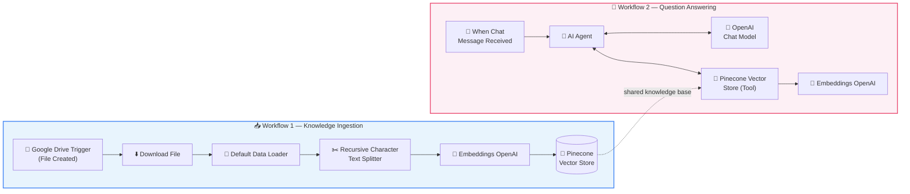

<div align="center">

# 🎓 Autonomous Academic Knowledge Assistant

### An end-to-end **RAG Agent** that answers university policy questions — accurately, instantly and without hallucinations.

<br/>


<br/>

**[✨ Features](#-key-features)** •
**[🏗 Architecture](#-system-architecture)** •
**[🛠 Tech Stack](#-tech-stack)** •
**[🚀 Setup](#-getting-started)** •
**[💬 Usage](#-usage)** •
**[👩‍💻 Author](#-author)**

</div>

---

## 📖 Overview

Students often struggle to find answers buried inside long academic guidebooks — attendance rules, grading scales, exam criteria, and more.

This project solves that with an **autonomous AI agent** that:

1. 📥 **Watches** a Google Drive folder for new documents
2. 🧠 **Converts** the content into vector embeddings and stores them in Pinecone
3. 💬 **Answers** student questions by searching that knowledge base *before* replying

> 🎯 **Result:** Every answer is grounded in the official university document — no guessing no made-up policies.

---

## ✨ Key Features

| | Feature | Description |
|---|---|---|
| ⚡ | **Automated Data Pipeline** | Triggers the moment a document is uploaded, downloads it, extracts the text and processes it automatically. |
| 🔍 | **Vector Search Engine** | Uses OpenAI `text-embedding-3-small` with a Pinecone serverless index for fast dense-vector retrieval. |
| 🤖 | **Autonomous Tool-Calling** | The AI Agent decides on its own to query the vector database before answering each question. |
| 🎯 | **Strict Accuracy** | Responses follow university guidelines only — attendance rules, grading scale, exam criteria. |
| ✂️ | **Smart Chunking** | Recursive Character Text Splitter keeps context intact for better retrieval quality. |
| ☁️ | **Fully Cloud-Based** | Runs on n8n Cloud — no servers to manage. |

---

## 🏗 System Architecture

The project is made of **two connected workflows** inside one n8n canvas.



### 🔄 Workflow 1 — Knowledge Ingestion

| Step | Node | Purpose |
|:---:|---|---|
| 1️⃣ | **Google Drive Trigger** | Fires whenever a new file is created in the monitored folder |
| 2️⃣ | **Download File** | Fetches the uploaded document |
| 3️⃣ | **Default Data Loader** | Extracts the raw text content |
| 4️⃣ | **Recursive Character Text Splitter** | Breaks the text into overlapping chunks |
| 5️⃣ | **Embeddings OpenAI** | Converts each chunk into a vector |
| 6️⃣ | **Pinecone Vector Store** | Inserts the vectors into the index |

### 💬 Workflow 2 — Question Answering

| Step | Node | Purpose |
|:---:|---|---|
| 1️⃣ | **When Chat Message Received** | Receives the student's question |
| 2️⃣ | **AI Agent** | Orchestrates reasoning and decides when to use tools |
| 3️⃣ | **OpenAI Chat Model** | GPT-4o-mini generates the final answer |
| 4️⃣ | **Pinecone Vector Store (Tool)** | Retrieves the most relevant policy chunks |
| 5️⃣ | **Embeddings OpenAI** | Embeds the question for similarity search |

---

## 🛠 Tech Stack

| Layer | Technology |
|---|---|
| 🧩 **Orchestration** | n8n Cloud |
| 🗄 **Vector Database** | Pinecone (Serverless) |
| 🧠 **LLM** | OpenAI GPT-4o-mini |
| 🧬 **Embeddings** | OpenAI `text-embedding-3-small` |
| 📂 **Document Source** | Google Drive |
| 📚 **Knowledge Base** | Academic & Student Policy Guidebook |

---

## 🚀 Getting Started

### ✅ Prerequisites

- [ ] An [n8n Cloud](https://n8n.io) account
- [ ] An [OpenAI](https://platform.openai.com) API key
- [ ] A [Pinecone](https://www.pinecone.io) account with a serverless index
- [ ] A Google account with Google Drive access

### 📋 Installation

**1️⃣ Import the workflow**
Open your n8n workspace → *Import from File* → select `workflow.json`.

**2️⃣ Create the Pinecone index**
Create a serverless index with dimension **1536** (matches `text-embedding-3-small`).

**3️⃣ Connect your credentials**

| Credential | Used By |
|---|---|
| 🔑 OpenAI API | Embeddings nodes + Chat Model |
| 🔑 Pinecone API | Both Pinecone Vector Store nodes |
| 🔑 Google Drive OAuth2 | Drive Trigger + Download File |

**4️⃣ Choose your Drive folder**
In the *Google Drive Trigger* node, select the folder to monitor.

**5️⃣ Upload your document**
Drop the Academic & Student Policy Guidebook into that folder, then run the ingestion workflow so it gets indexed.

**6️⃣ Publish & chat**
Activate the workflow and click **Open chat**.

---

## 💬 Usage

Once the guidebook is indexed, ask anything:

```text
👩‍🎓 Student : What is the minimum attendance required to sit in the exam?
🤖 Assistant: According to the university policy, students must maintain ...

👩‍🎓 Student : How is the grading scale defined?
🤖 Assistant: The grading scale in the guidebook is as follows ...
```

### 🧪 Sample Questions

- 📌 *What is the attendance policy?*
- 📌 *What are the exam eligibility criteria?*
- 📌 *How is GPA / grading calculated?*
- 📌 *What happens if a student misses an exam?*

---

## 🔐 How It Avoids Hallucinations

```text
 Student Question
        │
        ▼
 ┌──────────────┐     ┌────────────────────┐
 │  AI Agent    │────▶│ Search Pinecone    │
 └──────────────┘     │ (policy chunks)    │
        ▲             └─────────┬──────────┘
        │                       │
        └───────  Answer built ONLY from retrieved context
```

The agent **always retrieves first**, then answers using only what it found in the official document.

---

## 🗺 Roadmap

- [x] Automated ingestion from Google Drive
- [x] Vector search with Pinecone
- [x] Autonomous tool-calling agent
- [ ] 🧠 Add conversational memory
- [ ] 📱 Connect to WhatsApp / Telegram
- [ ] 🌐 Embed chat widget on a university website
- [ ] 🌍 Multi-language support (English + Urdu)
- [ ] 📊 Analytics dashboard for common questions

---

## 📁 Project Structure

```text
📦 academic-knowledge-assistant
 ┣ 📜 workflow.json      # n8n workflow export
 ┣ 📜 README.md          # Project documentation
 
```

---

## 👩‍💻 Author

<div align="center">

**Hamna Asif**
*Full-Stack Developer • UI/UX Designer • AI Specialist*

[](https://github.com/Hamna-Asif05)
[](https://www.linkedin.com/in/hamna-asif5)

</div>

---

<div align="center">

### ⭐ If you found this project useful, please give it a star!

Made with ❤️ using **n8n**, **Pinecone** & **OpenAI**

</div>
